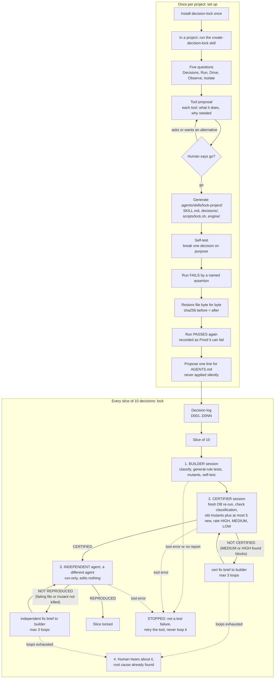

<p align="center"></p>

<p align="center">
  
  
  
  
  
</p>

# decision-lock

Lock every design decision with a test that fails if the decision is dropped: slice, build, certify, independently reproduce, loop.

One-page explainer: [docs/explainer.html](docs/explainer.html)

A written decision log is the source of truth. Each decision (`D001`, `D002`, ...) becomes a test named after it, run against a real throwaway Postgres (Docker + pgTAP). To prove the test can fail, every test comes with mutants: deliberately broken copies of the code that the test must catch. Work is cut into slices of 10 decisions, and each slice is built, certified and independently reproduced by different agents before any human is bothered.

<p align="center"></p>

## Why

Regulated industries need traceability: for every requirement, point at the evidence that it is met. Software teams rarely do this, and long decision lists get quietly dropped, especially when AI agents do the work. Here every decision has a test that proves it, and a mutant that proves the test is not decoration. A decision that is not built yet is not hidden either: its test fails with `DNNN: not built yet`, so the gap stays visible.

<p align="center"></p>

## How it works

decision-lock is a generator. The generic skill is saved once; in any project you tell your agent (or follow it yourself) "run the create-decision-lock skill" and it writes a project-specific `lock-<project>` skill into that project at `.agents/skills/lock-<project>/`. There is no one-size-fits-all check, so the generic skill builds the bespoke one. That lock skill then guards every slice of 10 decisions. One diagram covers both halves: set up once, then lock slice after slice.



1. **Five questions** (`templates/five-questions.md`): Decisions (where is the log, how are ids numbered), Run (how a throwaway copy starts), Drive (which test framework asserts each decision), Observe (what evidence is kept), Isolate (can slices run in parallel, each with its own copy and container).
2. **Tool proposal** (`templates/tool-proposal.md`): every tool with what it does and why this project needs it. The generator then waits for your go; ask it to explain a tool or offer an alternative.
3. **Generate**: `scripts/create-lock.sh <project-dir> <name> --approved` (it refuses without `--approved`). Output layout, one folder:

```
.agents/skills/lock-<name>/
  SKILL.md              ## Launch, ## Doctor, ## Drive, ## Evidence, ## Cleanup, ## Helpers
  decisions/D001.md ... one file per decision: text, rule class, tests, mutants, status
  scripts/lock.sh       ONE CLI: launch | doctor | run <slice|ids> | evidence | cleanup | selftest
  scripts/lock.ps1      Windows entry point (calls lock.sh)
  engine/               unchanged db.sh, env.sh, run_decision_tests.sh, Dockerfile
```

   Every `lock.sh` subcommand prints one JSON object, such as `{"ok":true,"cmd":"run","decisions_passed":3,"mutants_killed":9,...,"verdict":"LOCKED"}`.
4. **Self-test** (`lock.sh selftest <id>`): break one decision on purpose, show the run fails by a named assertion, restore the file byte for byte (hashes compared), show the run passes. **A check you have never seen fail proves nothing.**
5. **Agent rule** (`templates/agents-md-rule.md`): the generator proposes one line for AGENTS.md: "Before you call any change that touches a recorded decision done, run the lock-<project> skill for those decisions and show its evidence." It is only written if you agree.
6. **Teach mode** (`templates/teach-example.md`): add a decision by giving one example of good data and one of bad data (or one real failing case). The builder turns it into a test plus a mutant.

The generated tree for the worked example is in `examples/orders/.agents/skills/lock-example/`, and its recorded proof is in `examples/orders/handoff/evidence/`.

Break-and-restore proof from the worked example (decision D003):

```
{"ok":true,"cmd":"selftest","decision":"D003","mutant":"d_003_get_order_ignores_customer.sql","broken_run":"FAILED","failed_assertions":"D003-04","restored_file":"db/001_schema.sql","hash_before":"d850729c...66b1","hash_broken":"3f85ad3a...0bf5","hash_after":"d850729c...66b1","hash_match":true,"restored_run":"PASSED"}
```

**Every slice** runs the second half of the chart. Slices run in parallel, each in its own copy of the repo and its own database container. A watcher checks every 30 minutes ([docs/WATCHER.md](docs/WATCHER.md)).

Pass criteria:
- **CERTIFIED**: no MEDIUM or HIGH problem. LOW problems are listed but never block.
- **REPRODUCED**: every test file passes and every mutant is killed by a named failing assertion (0 survived, 0 crashed).

<p align="center"></p>

## Quick start (the worked example)

```bash
scripts/db.sh build                      # once: Postgres 16 image with pgTAP + pg_prove
export DL_ROOT=examples/orders
scripts/db.sh start                      # throwaway container decision-lock-example
scripts/run_decision_tests.sh            # 3 decisions: tests pass clean, every mutant killed
scripts/db.sh stop
```

Expected tail of the run:

```
PASS  clean   D003
killed  d_003_get_order_ignores_customer.sql  [D003-04]
killed  d_003_idless_lookup_added.sql  [D003-02]
killed  d_003_table_select_granted.sql  [D003-07]
mutants: 9 killed, 0 crashed, 0 survived
```

Or run the generated skill for the example (needs only bash and Docker):

```bash
cd examples/orders/.agents/skills/lock-example
scripts/lock.sh launch && scripts/lock.sh doctor && scripts/lock.sh run
scripts/lock.sh selftest D003 && scripts/lock.sh evidence
scripts/lock.sh cleanup
```

Then use it on your own project (or run `create-decision-lock` and let it generate the skill):

1. Write the decision log (`templates/decision-log.example.md` shows the shape). One decision per entry, stable ids.
2. Put your schema in `db/*.sql` and your tests in `tests/pgtap/decisions/` and `tests/mutants/decisions/`. Keep this repo checked out; its scripts work on any project through `DL_ROOT`.
3. `scripts/new-slice.sh <project> D001-D010 ../slice-D001-D010 decision-log.md` makes the slice copy (it also copies `scripts/`, the Dockerfile and `templates/` into it, and renders the briefs).
4. Copy `templates/decision-lock.agents.example` to `decision-lock.agents` and fill in a command per role, then `scripts/pipeline.sh --slice D001-D010 --dir ../slice-D001-D010` (PowerShell: `scripts/pipeline.ps1 -Slice D001-D010 -Dir ..\slice-D001-D010`)

<p align="center"></p>

## Requirements

- Docker, with permission to run containers.
- bash (macOS, Linux, or Git Bash / WSL on Windows). PowerShell 5+ only for `pipeline.ps1`.
- A Postgres image with pgTAP and `pg_prove`. `docker/Dockerfile` builds one (`postgres:16` + `postgresql-16-pgtap` + `libtap-parser-sourcehandler-pgtap-perl`). Set `IMAGE` in `decision-lock.env` to use your own.
- An agent (any CLI, or a human) for each role: builder, certifier, independent runner, fixer. Their commands live in one `decision-lock.agents` file; copy `templates/decision-lock.agents.example`, which has commented examples for several CLIs and no default. Check each CLI's current flags: they change.
- The one hard rule: the certifier and the independent runner must be a different agent/session from the builder. A different vendor is recommended for the independent runner.

Configuration (all optional): `decision-lock.env` in the project root, or environment variables: `IMAGE`, `CONTAINER`, `DBNAME`, `SCHEMA_DIR`, `DL_ROOT`, `DL_AGENTS` (path to the agents file).

<p align="center"></p>

## Install as a skill

`SKILL.md` at the repo root is the skill, and it is plain markdown any agent (or human) can follow. Keep the repo checked out where the agent can read `SKILL.md`, `scripts/` and `templates/`, then tell the agent: "For decision-lock work, read decision-lock/SKILL.md first." Put that sentence in the project's `AGENTS.md`, the open cross-agent file. Agents that read a different file (for example CLAUDE.md or GEMINI.md) can point that file at AGENTS.md.

The generated project skill lives at the neutral path `.agents/skills/lock-<project>/`. If your tool looks for skills in its own folder, symlink or copy that directory there; the content is the same.

Optional, as one example of many: tools with slash commands can install `commands/create-decision-lock.md`. It only wraps the plain instruction.

Then ask the agent to "lock the decisions in decision-log.md with decision-lock" and it follows `SKILL.md`.

<p align="center"></p>

## Contents

| Path | What |
|---|---|
| `SKILL.md` | The method as instructions for an agent |
| `templates/` | Decision log example, builder / certifier / independent / fix briefs, report skeletons (placeholders `{{SLICE}}`, `{{CONTAINER}}`, ...) |
| `commands/create-decision-lock.md` | Optional slash-command wrapper (one example of how to invoke the generator) |
| `scripts/create-lock.sh` | Generator: writes `.agents/skills/lock-<name>/` into a project (needs `--approved`) |
| `templates/five-questions.md`, `tool-proposal.md`, `agents-md-rule.md`, `teach-example.md` | Discovery, approval gate, agent rule, teach mode |
| `templates/project-skill/` | What the generator renders: SKILL.md, `decisions/decision.md`, `scripts/lock.sh`, `lock.ps1` |
| `scripts/pipeline.ps1`, `pipeline.sh` | The orchestrator for one slice |
| `scripts/run_decision_tests.sh` | Strict runner: KILLED only by a named failing assertion; CRASHED and SURVIVED fail the run |
| `scripts/db.sh`, `env.sh` | Throwaway container: `build`, `start`, `fresh`, `stop` |
| `scripts/new-slice.sh` | Private slice copy with its own container and rendered briefs |
| `docker/Dockerfile` | Postgres + pgTAP image |
| `examples/orders/` | A 3-decision worked example with general-rule tests, 9 mutants, sample reports, the generated `.agents/skills/lock-example/` tree and its break-and-restore proof |
| `docs/LESSONS.md` | The eleven hard-won lessons with the failure story for each |
| `docs/WATCHER.md` | Running the 30-minute watcher |

<p align="center"></p>

## Safety

Mutants are destructive. Run only against containers this tool created (they carry the label `decision-lock=1`; `db.sh` refuses any other container with the same name). Never point it at a live database.

<p align="center"></p>

## License

License: MIT, see LICENSE.
