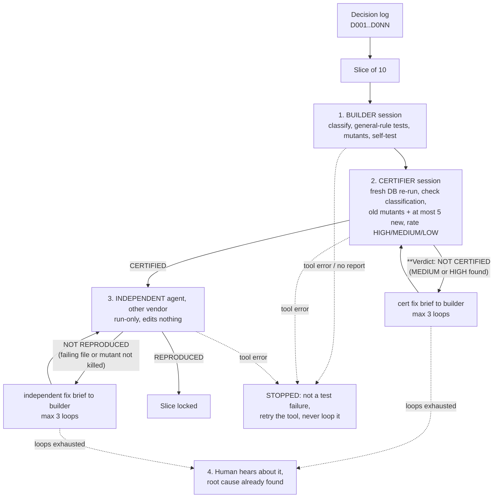

# decision-lock

Lock every design decision with a test that fails if the decision is dropped: slice, build, certify, independently reproduce, loop.

A written decision log is the source of truth. Each decision (`D001`, `D002`, ...) becomes a test named after it, run against a real throwaway Postgres (Docker + pgTAP). To prove the test can fail, every test comes with mutants: deliberately broken copies of the code that the test must catch. Work is cut into slices of 10 decisions, and each slice is built, certified and independently reproduced by different agents before any human is bothered.

## Why

Regulated industries need traceability: for every requirement, point at the evidence that it is met. Software teams rarely do this, and long decision lists get quietly dropped, especially when AI agents do the work. Here every decision has a test that proves it, and a mutant that proves the test is not decoration. A decision that is not built yet is not hidden either: its test fails with `DNNN: not built yet`, so the gap stays visible.

## The flow (per slice)



Slices run in parallel, each in its own copy of the repo and its own database container. A watcher checks every 30 minutes ([docs/WATCHER.md](docs/WATCHER.md)).

Pass criteria:
- **CERTIFIED**: no MEDIUM or HIGH problem. LOW problems are listed but never block.
- **REPRODUCED**: every test file passes and every mutant is killed by a named failing assertion (0 survived, 0 crashed).

## Quick start (the worked example)

```bash
scripts/db.sh build                      # once: Postgres 16 image with pgTAP + pg_prove
export DL_ROOT=examples/orders
scripts/db.sh start                      # throwaway container decision-lock-example
scripts/run_decision_tests.sh            # 3 decisions: tests pass clean, every mutant killed
scripts/db.sh stop
```

Expected tail of the run:

```
PASS  clean   D003
killed  d_003_get_order_ignores_customer.sql  [D003-04]
killed  d_003_idless_lookup_added.sql  [D003-02]
killed  d_003_table_select_granted.sql  [D003-07]
mutants: 9 killed, 0 crashed, 0 survived
```

Then use it on your own project:

1. Write the decision log (`templates/decision-log.example.md` shows the shape). One decision per entry, stable ids.
2. Put your schema in `db/*.sql` and your tests in `tests/pgtap/decisions/` and `tests/mutants/decisions/`. Keep this repo checked out; its scripts work on any project through `DL_ROOT`.
3. `scripts/new-slice.sh <project> D001-D010 ../slice-D001-D010 decision-log.md` makes the slice copy (it also copies `scripts/`, the Dockerfile and `templates/` into it, and renders the briefs).
4. `scripts/pipeline.sh --slice D001-D010 --dir ../slice-D001-D010` (PowerShell: `scripts/pipeline.ps1 -Slice D001-D010 -Dir ..\slice-D001-D010`)

## Requirements

- Docker, with permission to run containers.
- bash (macOS, Linux, or Git Bash / WSL on Windows). PowerShell 5+ only for `pipeline.ps1`.
- A Postgres image with pgTAP and `pg_prove`. `docker/Dockerfile` builds one (`postgres:16` + `postgresql-16-pgtap` + `libtap-parser-sourcehandler-pgtap-perl`). Set `IMAGE` in `decision-lock.env` to use your own.
- An agent CLI for the builder and certifier roles: [Claude Code](https://claude.com/claude-code) (`claude`) is the default.
- A CLI from a different vendor for the independent run: Grok CLI (`grok`, default) or Codex (`codex`). Pick the kind by file name; `pipeline.*` has one `case` per kind if you want to add another. Check each CLI's current flags: they change.

Configuration (all optional): `decision-lock.env` in the project root, or environment variables: `IMAGE`, `CONTAINER`, `DBNAME`, `SCHEMA_DIR`, `DL_ROOT`, `DL_BUILDER_CLI`, `DL_INDEPENDENT_CLI`.

## Install as a skill

`SKILL.md` at the repo root is the skill. Put the repo (or a copy) where your agent looks for skills:

| Agent | Where |
|---|---|
| Claude Code | `~/.claude/skills/decision-lock/` (all projects) or `<project>/.claude/skills/decision-lock/` |
| Cursor | Copy `SKILL.md` into `<project>/.cursor/rules/decision-lock.mdc` (add frontmatter `alwaysApply: false` and a `description`), keep the repo checked out for `scripts/` and `templates/` |
| Codex, Grok, others | Reference `SKILL.md` from `AGENTS.md` (or the CLI's equivalent rules file): "For decision-lock work, read decision-lock/SKILL.md first." |

```bash
git clone <this repo> ~/.claude/skills/decision-lock
```

Then ask the agent to "lock the decisions in decision-log.md with decision-lock" and it follows `SKILL.md`.

## Contents

| Path | What |
|---|---|
| `SKILL.md` | The method as instructions for an agent |
| `templates/` | Decision log example, builder / certifier / independent / fix briefs, report skeletons (placeholders `{{SLICE}}`, `{{CONTAINER}}`, ...) |
| `scripts/pipeline.ps1`, `pipeline.sh` | The orchestrator for one slice |
| `scripts/run_decision_tests.sh` | Strict runner: KILLED only by a named failing assertion; CRASHED and SURVIVED fail the run |
| `scripts/db.sh`, `env.sh` | Throwaway container: `build`, `start`, `fresh`, `stop` |
| `scripts/new-slice.sh` | Private slice copy with its own container and rendered briefs |
| `docker/Dockerfile` | Postgres + pgTAP image |
| `examples/orders/` | A 3-decision worked example with general-rule tests, 9 mutants, sample reports |
| `docs/LESSONS.md` | The ten hard-won lessons with the failure story for each |
| `docs/WATCHER.md` | Running the 30-minute watcher |

## Safety

Mutants are destructive. Run only against containers this tool created (they carry the label `decision-lock=1`; `db.sh` refuses any other container with the same name). Never point it at a live database.

## License

License: TBD (private).
